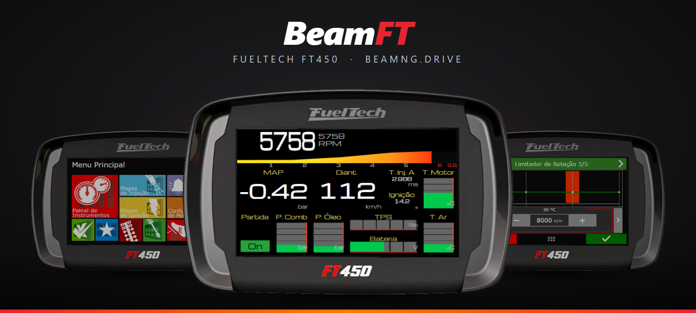
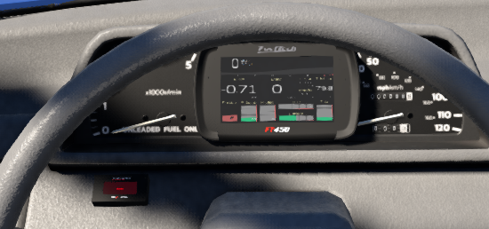
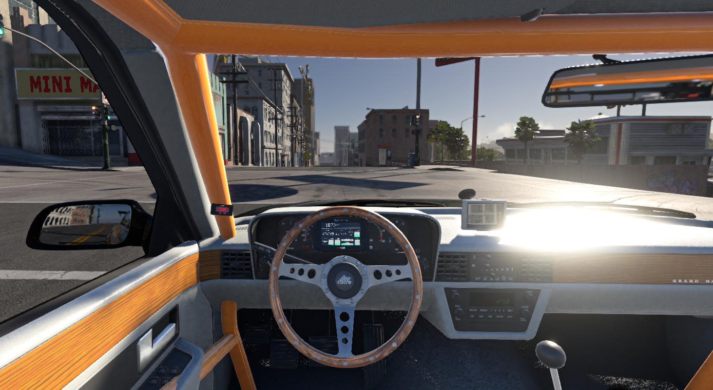
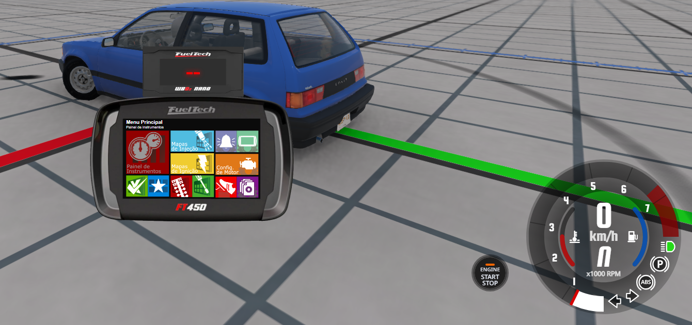
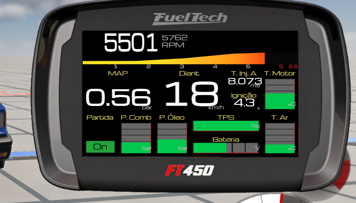
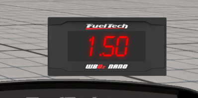
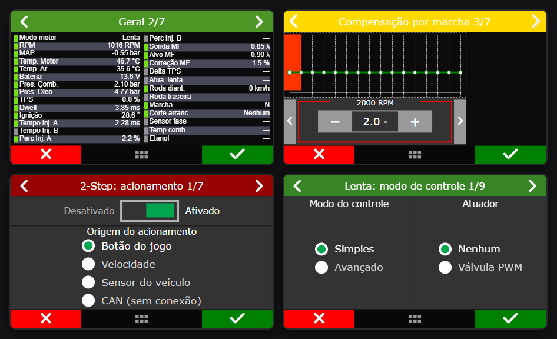
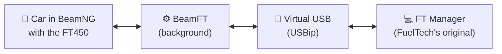
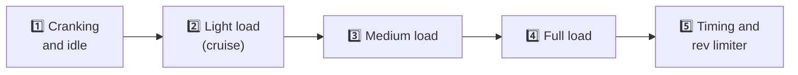

<p align="center">
  
</p>

<p align="center">
  <a href="README.md">🇧🇷 Português</a> &nbsp;|&nbsp; <b>🇺🇸 English</b>
</p>

<p align="center">
  
  
  
  
  
  
</p>

<p align="center">
  <a href="https://github.com/Jonhline/BeamFT/releases/download/v0.2.0-beta.1/BeamFT-Setup.exe"></a>
  &nbsp;
  <a href="https://github.com/Jonhline/BeamFT/releases/download/v0.2.0-beta.1/beamft.zip"></a>
</p>

<p align="center">
  <a href="#-what-it-is">What it is</a> ·
  <a href="#-whats-in-the-mod">What's in it</a> ·
  <a href="#-inside-the-game">Screenshots</a> ·
  <a href="#-what-ft-manager-is">FT Manager</a> ·
  <a href="#-which-version-to-download">Download</a> ·
  <a href="#-installation">Install</a> ·
  <a href="#-quick-guide-from-zero-to-the-first-pull">Quick guide</a> ·
  <a href="#-engine-health">Engine health</a> ·
  <a href="#-what-the-beamft-ft450-can-do">Features</a> ·
  <a href="#-troubleshooting">Help</a>
</p>

> The in-game FT450 screen is in Portuguese, like the Brazilian FT450. This page explains everything in English.

---

## 🏁 What it is

**BeamFT** puts a **FuelTech FT450**, a programmable engine management system (ECU) very popular in Brazil, inside **BeamNG.drive**.

You fit the FT450 to a car in the game, build the fuel and ignition maps, and **the engine responds to your tune**: it starts or it doesn't, runs smooth or misfires, makes power, heats up, knocks and **can blow up**.

It's a way to **learn how to tune an FT without risking a real engine**, including with FuelTech's **original FT Manager** software.

---

## 🧰 What's in the mod

| | |
|---|---|
| 🖥️ **3D FT450 on the dash** | The FT450 shows up on the dash of any car you fit it to, placed by the driver's view. Click it for a close-up and to use it; right-click to go back. |
| 📱 **FT450 HUD app** | The same screen as an app in the game's UI, so you can tune from any camera. Resizable. |
| 🟢 **WB-O2 Nano wideband** | FuelTech's lambda gauge, also in 3D on the dash and as a HUD app. It shows the **real mixture** the engine is burning: the most important instrument when tuning. |
| 🔌 **FT Manager link** | The in-game FT450 shows up in FT Manager over USB, like a real one *(full install)*. |
| 📈 **Datalogger** | Records your pulls and exports `.ftml` for FT Manager's datalogger *(full install)*. |
| 💥 **An engine that feels your tune** | Mixture, timing, boost, revs and temperature affect power, misfires and wear. |

---

## 📸 Inside the game

<p align="center">
  <br>
  <sub><b>3D FT450 on the dash.</b> Click it to zoom in and edit maps without leaving the car.</sub>
</p>

<table>
  <tr>
    <td width="50%"></td>
    <td width="50%"></td>
  </tr>
  <tr>
    <td><sub><b>On the road.</b> The FT450 in the gauge cluster and the Nano on the pillar, in any car.</sub></td>
    <td><sub><b>In the game UI.</b> The FT450 and Nano apps on the HUD, to tune from any camera.</sub></td>
  </tr>
  <tr>
    <td></td>
    <td></td>
  </tr>
  <tr>
    <td><sub><b>Live dashboard.</b> RPM, MAP, speed, injection time, timing, pressures and temperatures.</sub></td>
    <td><sub><b>WB-O2 Nano wideband.</b> The engine's real lambda. Here 1.50: a very lean mixture.</sub></td>
  </tr>
</table>

<p align="center">
  <br>
  <sub>FT450 menus: diagnostics, per-gear compensation, 2-step and idle. Screens, menus and fonts follow the original FT450, in Portuguese.</sub>
</p>

---

## 💻 What FT Manager is

**FT Manager** is **FuelTech's official, free desktop software**. In the real world, a tuner plugs a laptop into the car's FT450 with a **USB cable** and, in FT Manager:

| | |
|---|---|
| 📊 **Edits the maps** | Fuel and ignition tables, cranking, idle, temperature corrections |
| ✂️ **Sets up cuts** | Rev limiter, 2-step, overrun fuel cut |
| 💾 **Writes and reads** | Sends the map to the FT450 and reads back what's in it |
| 👀 **Watches it live** | RPM, MAP, TPS, lambda, timing and temperatures while the engine runs |
| 📈 **Analyses logs** | Opens datalogger recordings to see what happened during a pull |
| 🖥️ **Builds the dash** | Chooses which gauges show on the FT450 screen |

**It's the exact program a real tuner uses.** Learning it here means learning the real tool.

> 📥 Download FT Manager from **FuelTech's official website**. It's free, and BeamFT **doesn't** include any FuelTech software.

### 🔌 How BeamFT connects FT Manager to the game

The game has no USB cable. So BeamFT **creates a virtual FT450** that Windows sees as **a real USB device**, using the free **USBip** driver, which the installer sets up for you. As far as FT Manager is concerned, **an FT450 is plugged into USB**.



- 🔢 **Every car has its own FT450**, with its own serial number and its map stored in it. Switching cars is like plugging a different ECU into the cable.
- 💾 **Writing** in FT Manager sends the map to the car's FT450. It stays there after you close FT Manager and the game.
- 👀 With the game running, FT Manager **shows the car's readings live**.
- 🖥️ The in-game FT450 screen and FT Manager edit **the same map**.

> 💡 FT Manager is **optional**. With **beamft.zip** you can tune everything from the in-game FT450 screen.

---

## 📦 Which version to download

| | 📁 **beamft.zip** <br><sub>mod only</sub> | 🛠️ **BeamFT-Setup.exe** <br><sub>full install</sub> |
|---|:---:|:---:|
| Requires | BeamNG.drive | BeamNG.drive + FT Manager |
| 3D FT450 and Nano on the dash | ✅ | ✅ |
| FT450 and Nano HUD apps | ✅ | ✅ |
| Connects to **FT Manager** over virtual USB | — | ✅ |
| **`.ftml`** datalogs for FT Manager | — | ✅ |
| Passwords, axis editing, USB memory | — | ✅ |
| Logs | JSON | JSON + `.ftml` |

**Not sure?** Just want to tune in the game? **ZIP**. Want to learn FT Manager? **Setup**.

> ⚠️ Use **one** option at a time. If the full install finds `beamft.zip`, it disables it and keeps it as a backup.

All versions: **[Releases](https://github.com/Jonhline/BeamFT/releases)** · Verify files: [SHA256SUMS.txt](https://github.com/Jonhline/BeamFT/releases/download/v0.2.0-beta.1/SHA256SUMS.txt)

---

## 🔧 Installation

<details open>
<summary><b>📁 beamft.zip: mod only</b></summary>

1. Copy `beamft.zip` **without extracting** into BeamNG's `mods` folder:<br>
   `%LOCALAPPDATA%\BeamNG\BeamNG.drive\current\mods`
2. Start the game. The mod shows up as **beamft** in the Mods list.

</details>

<details open>
<summary><b>🛠️ BeamFT-Setup.exe: full install</b></summary>

**First:** install **BeamNG.drive** (Steam) and **FT Manager** (FuelTech's website), in their default folders.

1. Run `BeamFT-Setup.exe`. The first screen checks what's already on your PC.
2. Pick a folder (default `C:\BeamFT`).
3. The installer downloads and sets up **USBip**. Windows will ask for permission: allow it.
4. Done! **Start the game from Steam, as usual.** BeamFT runs hidden, with no window, and switches on by itself when the game opens.

Python is bundled. Nothing else to install.

> 🛡️ **Windows warning:** the installer isn't digitally signed, so Windows may show *"Windows protected your PC"*. Click **More info → Run anyway**. Some antivirus software may also flag it, because BeamFT installs a USB driver and starts with Windows.

</details>

---

## 🚀 Quick guide: from zero to the first pull

### 1. Fit the FT to the car

1. Pick a petrol car and open **Vehicle Config → Engine → Engine management**.
2. Select the **FT450** and the **injectors** (in lb/h). The FT450 and the Nano appear on the dash.
3. For the HUD app: **UI Apps → Vehicle info → BeamFT FT450 / BeamFT Nano**. In the interior camera the apps hide when the car already has the FT and the Nano on the dash.

### 2. Start it on the base map

A new FT450 comes with a **base map** sized to the car's engine and injectors: rich, with fixed timing. **It starts, but runs rough.** From here on, the tune is yours.

> 💾 With the full install, open FT Manager, **read** the FT450 and **save a copy of the map to your PC** before changing anything. The FT450 has three tune slots: note which one you're using.

### 3. Tune by region, lightest to heaviest



| Region | What to watch | How to fix it |
|---|---|---|
| **Cranking and idle** | Does it start quickly? Is the idle steady? | Adjust the **cranking injection time** and the **after-start** enrichment. Hunting idle: check the mixture in that MAP range before touching idle control. |
| **Light load** | Nano lambda near **1.00** | Lambda **above** target = lean → **increase** the cell's injection time. **Below** = rich → decrease it. |
| **Medium and full load** | Lambda **richer** than 1.00 under load (even richer with a turbo) | Raise the load gradually. Lean at wide-open throttle is the fastest way to break the engine. |
| **Timing** | Power gained per degree | Advance **1 to 2° at a time**. When power stops rising, stop: more advance only brings knock. |
| **Rev limiter** | Cut RPM | Keep the engine's stock limit while you sort out the mixture. |

**Golden rules:**
- ✋ **Change one thing at a time**, write it and test again.
- 🧪 **Always watch the Nano**: it shows what the engine is really burning.
- 📈 **Record the datalogger** (25 Hz is a good start) and compare before and after.
- 🛡️ **Set up the FT's alerts and safety mode** before pushing hard.

> 📖 The **Guia BeamFT** shortcut in the Start menu (full install) goes deeper into each step: first map, protections and datalogger (in Portuguese).

### 🎮 FT450 screen controls

| Key (numpad) | Action |
|:---:|---|
| <kbd>*</kbd> | Hands the numpad to the FT450 (**NUM** shows up). Again: back to the camera. |
| <kbd>8</kbd> <kbd>2</kbd> <kbd>4</kbd> <kbd>6</kbd> | Navigate |
| <kbd>5</kbd> / <kbd>Enter</kbd> | Open / confirm |
| <kbd>0</kbd> | Back |
| <kbd>+</kbd> <kbd>−</kbd> | Change value (hold to speed up) |
| <kbd>7</kbd> <kbd>9</kbd> | Change RPM row or page |

Keys can be rebound in **Options → Controls → "FT450: …"**. The position of the FT450 and the Nano on the dash can be fine-tuned in **Vehicle Config**, under *FuelTech - tela no painel* and *FuelTech - Nano no painel*.

---

## ❤️ Engine health

Each car's engine has a **health from 0 to 100%**. It drops when the engine runs past its limits and **doesn't come back on its own**, just like a real engine.

**What happens as it drops:**

| Health | Effect |
|:---:|---|
| **100 to 85%** | Loses up to about 10% of its power |
| **85 to 10%** | Power keeps falling, down to about half |
| **Below 10%** | 💥 **The engine seizes**: game over until you reset the car |

### What wears the engine

| Cause | What it is | Signs | How to avoid it |
|---|---|---|---|
| **Knock** | The mixture ignites too early, hammering pistons and rods | Power loss at high load | Less timing at high load, richer mixture, less boost |
| **Lean under load** | Too little fuel with the throttle open: combustion runs too hot | High lambda on the Nano under load | More injection time in that region; injectors big enough |
| **Overboost** | Turbo above its target | MAP higher than planned | A realistic boost target and a max-MAP alert |
| **Over-rev** | Going past what the engine can take | Wrong downshift, limiter set too high | A rev limiter below the engine's physical limit |
| **Overheating** | Coolant or oil too hot while the engine runs | Temperature climbing on long pulls | A temperature alert; let it cool down |
| **Hot exhaust** | Very hot gases for too long burn the valves | Lean mixture and retarded timing | A correct mixture, without retarding timing too much |

### What **doesn't** break it, but gets in the way

- 🌫️ **Too rich:** the engine misfires, loses power, fouls the plugs and **smokes**.
- 🌊 **Too much fuel when cranking:** the engine **floods** and takes long to start.
- 🐢 **Unstable idle:** only causes wear if you accelerate on a lean mixture.

> 🔄 **Resetting the car** in the game brings the engine back to 100%.

---

## ✅ What the BeamFT FT450 can do

Status in **v0.2**, compared with the original FT450's functions:

| Status | |
|:---:|---|
| ✅ | Works on the car |
| 🟡 | Works partly or in a simplified way |
| ❌ | Not yet |
| ➖ | The original FT450 doesn't have it either |

<details open>
<summary><b>⛽ Fuel</b></summary>

| Function | |
|---|:---:|
| Main map in ms: 2D by MAP or 3D by MAP × RPM | ✅ |
| RPM compensation | ✅ |
| Cranking, after-start and flood clear | ✅ |
| Engine and air temperature compensations | ✅ |
| Quick injection (acceleration enrichment) | ✅ |
| Overrun fuel cut | ✅ |
| Closed loop on the lambda sensor | ✅ |
| Injector deadtime | ✅ |
| Bank B | 🟡 treated as a second set of identical injectors |
| Per-cylinder trims | 🟡 applied as an average: the game doesn't separate cylinders |

</details>

<details open>
<summary><b>⚡ Ignition</b></summary>

| Function | |
|---|:---:|
| 2D / 3D ignition map | ✅ |
| Timing compensations (MAP, temperature, etc.) | ✅ |
| Cranking timing | ✅ |
| Ignition dwell | ✅ |
| Knock control (knock sensor) | ➖ |

</details>

<details open>
<summary><b>✂️ Cuts and drag racing</b></summary>

| Function | |
|---|:---:|
| Rev limiter (ignition or fuel cut) | ✅ |
| 2-step | ✅ |
| 3-step, Burnout and Roll Start | 🟡 configurable, still lightly tested in game |
| Traction control | ❌ |
| Boost control | ❌ |

</details>

<details open>
<summary><b>🔧 Engine and idle</b></summary>

| Function | |
|---|:---:|
| Idle by timing, with target by temperature and after-start | ✅ |
| Idle by PWM valve | 🟡 |
| Start button | ✅ |
| Electronic throttle and stepper motor | ➖ |

</details>

<details open>
<summary><b>🖥️ Screen, dash and protections</b></summary>

| Function | |
|---|:---:|
| Configurable instrument panel (up to 4 dashboards) | ✅ |
| Alerts: warning, safety mode and engine shutdown | ✅ |
| Passwords and custom splash screen | ✅ |
| Favourites and start screen | ✅ |
| Odometer and hour meter | ✅ |
| Tune manager (three slots) | 🟡 copy and delete still incomplete |
| Table axis editing | 🟡 main tables (up to 32 points) |

</details>

<details open>
<summary><b>📈 Datalogger and connection</b></summary>

| Function | |
|---|:---:|
| Read and write through FT Manager (USB) | ✅ |
| Live readings in FT Manager | ✅ |
| Internal datalogger, exported as `.ftml` | ✅ 1, 5, 25 and 50 Hz |
| Datalogger at 100 / 200 Hz | ❌ |
| CAN and extra sensors (fuel flow, etc.) | ❌ |

</details>

> 🔎 Where FuelTech doesn't publish how the firmware works, BeamFT follows its own documented rule. The goal is behaviour that makes sense for learning, not a copy of the firmware.

---

## ❓ Troubleshooting

<details>
<summary><b>FT Manager can't find the FT450</b></summary>

- The **game must be running** with a car that has the FT450.
- Check that **USBip** was installed (the installer tells you at the end).
- Look at `logs\watcher.log` in the BeamFT folder.

</details>

<details>
<summary><b>The car takes ages to start when hot</b></summary>

The **cranking** table is adding too much fuel and the engine **floods**. Lower the values at high temperatures.
If it's already flooded, crank with the **throttle above 70%**: the FT450 cuts fuel until the engine clears.

</details>

<details>
<summary><b>The engine broke "out of nowhere"</b></summary>

It's almost always **temperature** (long wide-open pulls) or a **lean mixture under load**. Record the datalogger and check lambda and temperatures at the moment it broke. See [Engine health](#-engine-health).

</details>

<details>
<summary><b>The game or FT Manager are in a different folder</b></summary>

Create a `paths.json` file in the BeamFT folder:

```json
{
  "game": "E:/Steam/steamapps/common/BeamNG.drive/Bin64/BeamNG.drive.x64.exe",
  "ftmanager": "D:/FuelTech/FTManager/FTManager.exe"
}
```

If BeamNG uses a different user folder, add `"userfolder"` with the folder that contains `current`. Then run `Preparar.cmd`.

</details>

<details>
<summary><b>How to uninstall</b></summary>

- **ZIP:** delete `beamft.zip` from the `mods` folder.
- **Full:** Start menu → **BeamFT → Desinstalar BeamFT**. Your FT450 maps stay in the BeamNG profile (`beamft-ecus`) and FT Manager is left untouched.

To just switch BeamFT off, use **Parar BeamFT** in the Start menu. It comes back when the game opens again, or with the **Ligar BeamFT** shortcut.

</details>

---

## 🚧 Limitations of this version

- **FT450** only for now.
- **Windows** only.
- **Petrol** engines only. Electric and diesel engines can't take the FT.
- Not every car or mod has been tested. Cars without reliable engine data use estimates.
- The effects are approximations for learning. **A map made in the game is not valid for a real engine.**

---

<sub>BeamFT is an independent project, not affiliated with <b>FuelTech</b> or <b>BeamNG GmbH</b>. FuelTech, FT450, WB-O2 Nano and FT Manager are trademarks of FuelTech. BeamFT doesn't include any FuelTech software: FT Manager is downloaded from FuelTech's official website.</sub>
