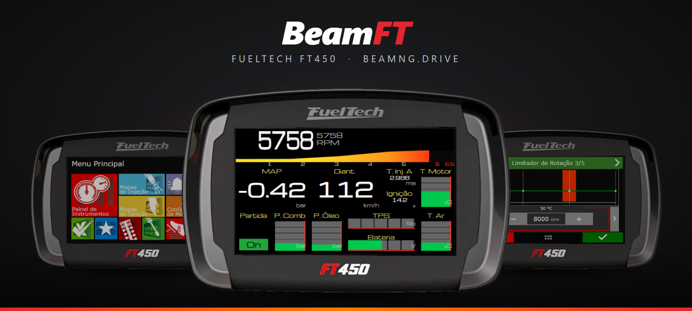
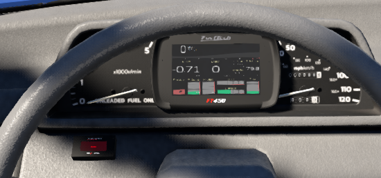
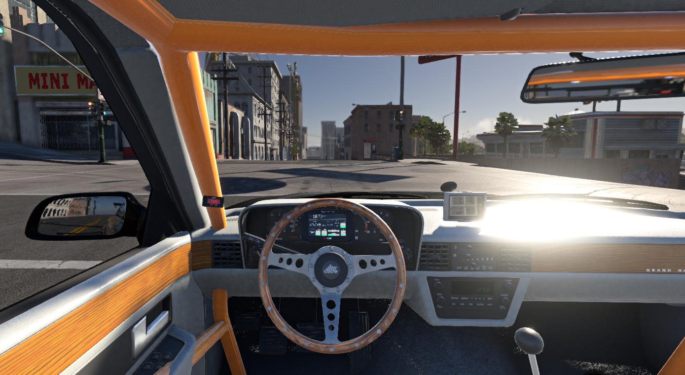
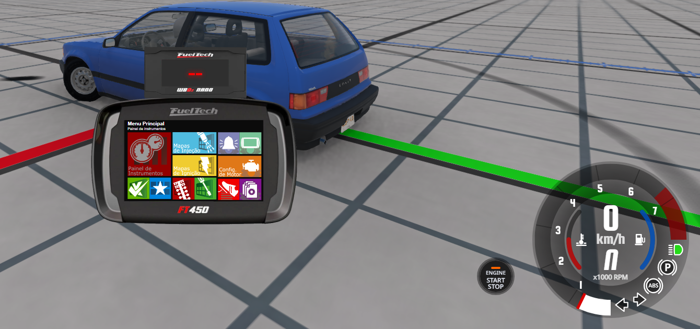
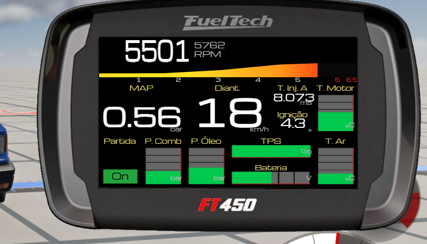
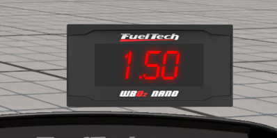
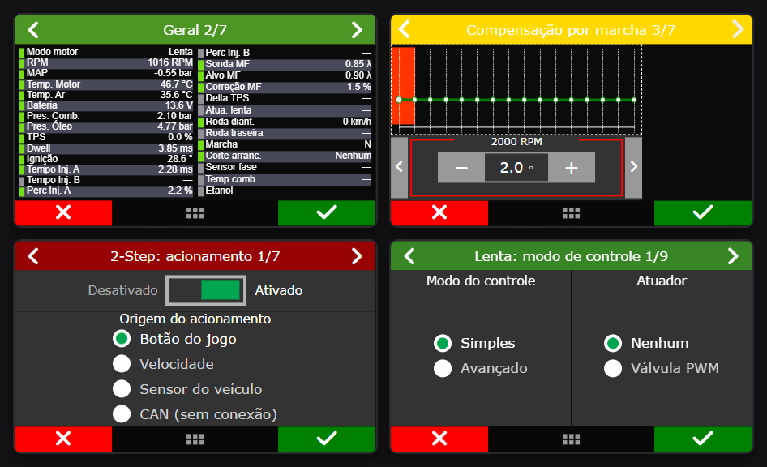
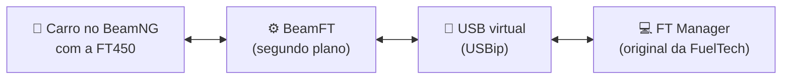
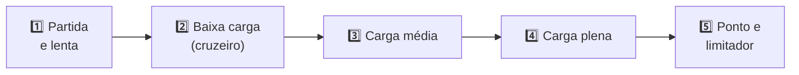

<p align="center">
  
</p>

<p align="center">
  <b>🇧🇷 Português</b> &nbsp;|&nbsp; <a href="README.en.md">🇺🇸 English</a>
</p>

<p align="center">
  
  
  
  
  
  
</p>

<p align="center">
  <a href="https://github.com/Jonhline/BeamFT/releases/download/v0.2.0-beta.1/BeamFT-Setup.exe"></a>
  &nbsp;
  <a href="https://github.com/Jonhline/BeamFT/releases/download/v0.2.0-beta.1/beamft.zip"></a>
</p>

<p align="center">
  <a href="#-o-que-é">O que é</a> ·
  <a href="#-o-que-vem-no-mod">O que vem</a> ·
  <a href="#-por-dentro-do-jogo">Fotos</a> ·
  <a href="#-o-que-é-o-ft-manager">FT Manager</a> ·
  <a href="#-qual-versão-baixar">Download</a> ·
  <a href="#-instalação">Instalação</a> ·
  <a href="#-guia-rápido-do-zero-à-primeira-puxada">Guia rápido</a> ·
  <a href="#-saúde-do-motor">Saúde do motor</a> ·
  <a href="#-o-que-a-ft450-do-beamft-já-faz">Funções</a> ·
  <a href="#-problemas-comuns">Ajuda</a>
</p>

---

## 🏁 O que é

O **BeamFT** coloca uma **FuelTech FT450**, injeção eletrônica programável muito usada no Brasil, dentro do **BeamNG.drive**.

Você instala a FT450 num carro do jogo, monta o mapa de combustível e de ignição, e **o motor responde ao seu acerto**: pega ou não pega, anda liso ou falhando, ganha força, esquenta, detona e **pode quebrar**.

É um jeito de **aprender a acertar uma FT sem arriscar um motor de verdade**, usando inclusive o **FT Manager original** da FuelTech.

---

## 🧰 O que vem no mod

| | |
|---|---|
| 🖥️ **FT450 em 3D no painel** | A FT450 aparece no painel de qualquer carro em que você a instalar, posicionada pela visão do motorista. Clique nela para ver de perto e mexer; botão direito volta. |
| 📱 **App da FT450 no HUD** | A mesma tela como app da interface do jogo, para acertar de qualquer câmera. Pode ser redimensionado. |
| 🟢 **Wideband WB-O2 Nano** | O medidor de lambda da FuelTech, também em 3D no painel e como app no HUD. Mostra a **mistura real** que o motor está queimando: é o instrumento mais importante do acerto. |
| 🔌 **Conexão com o FT Manager** | A FT450 do jogo aparece no FT Manager pelo USB, como uma FT de verdade *(instalação completa)*. |
| 📈 **Datalogger** | Grava as puxadas e exporta `.ftml` para o datalogger do FT Manager *(instalação completa)*. |
| 💥 **Motor que sente o acerto** | Mistura, ponto, pressão, rotação e temperatura afetam força, falhas e desgaste. |

## 📸 Por dentro do jogo

<p align="center">
  <br>
  <sub><b>FT450 em 3D no painel.</b> Clique nela para chegar perto e mexer nos mapas sem sair do carro.</sub>
</p>

<table>
  <tr>
    <td width="50%"></td>
    <td width="50%"></td>
  </tr>
  <tr>
    <td><sub><b>Na rua.</b> A FT450 no quadro de instrumentos e a Nano na coluna, em qualquer carro.</sub></td>
    <td><sub><b>Na interface do jogo.</b> Os apps da FT450 e da Nano no HUD, para acertar de qualquer câmera.</sub></td>
  </tr>
  <tr>
    <td></td>
    <td></td>
  </tr>
  <tr>
    <td><sub><b>Painel ao vivo.</b> RPM, MAP, velocidade, tempo de injeção, ponto, pressões e temperaturas.</sub></td>
    <td><sub><b>Wideband WB-O2 Nano.</b> A lambda real do motor. Aqui, 1.50: mistura muito pobre.</sub></td>
  </tr>
</table>

<p align="center">
  <br>
  <sub>Menus da FT450: diagnóstico, compensação por marcha, 2-step e lenta. Telas, menus e fontes seguem a FT450 original, em português.</sub>
</p>

---

## 💻 O que é o FT Manager

O **FT Manager** é o **programa oficial e gratuito da FuelTech** para computador. No mundo real, o preparador liga o notebook na FT450 do carro por um **cabo USB** e, pelo FT Manager:

| | |
|---|---|
| 📊 **Edita os mapas** | Tabelas de injeção e de ignição, partida, marcha lenta, correções por temperatura |
| ✂️ **Configura cortes** | Limitador de rotação, 2-step, corte na desaceleração |
| 💾 **Grava e lê** | Manda o mapa para a FT450 e lê de volta o que está nela |
| 👀 **Acompanha ao vivo** | RPM, MAP, TPS, lambda, ponto e temperaturas enquanto o motor funciona |
| 📈 **Analisa logs** | Abre os registros do datalogger para ver o que aconteceu numa puxada |
| 🖥️ **Monta o painel** | Escolhe quais mostradores aparecem na tela da FT450 |

**É exatamente o programa que um preparador usa.** Aprender nele é aprender a ferramenta de verdade.

> 📥 Baixe o FT Manager no **site oficial da FuelTech**. Ele é gratuito, e o BeamFT **não** inclui nenhum programa da FuelTech.

### 🔌 Como o BeamFT conecta o FT Manager ao jogo

O jogo não tem cabo USB. Por isso o BeamFT **cria uma FT450 virtual** que o Windows enxerga como **um aparelho USB de verdade**, com a ajuda do driver gratuito **USBip**, que o instalador configura sozinho. Para o FT Manager, **tem uma FT450 ligada no USB**.



- 🔢 **Cada carro tem a sua FT450**, com número de série próprio e o mapa guardado nela. Trocar de carro é como trocar a FT do cabo.
- 💾 **Gravar** no FT Manager manda o mapa para a FT450 do carro. Ele continua lá depois de fechar o FT Manager e o jogo.
- 👀 Com o jogo aberto, o FT Manager **mostra as leituras do carro ao vivo**.
- 🖥️ A tela da FT450 no jogo e o FT Manager mexem **no mesmo mapa**.

> 💡 O FT Manager é **opcional**. Com o **beamft.zip** dá para acertar tudo pela tela da FT450 dentro do jogo.

---

## 📦 Qual versão baixar

| | 📁 **beamft.zip** <br><sub>só o mod</sub> | 🛠️ **BeamFT-Setup.exe** <br><sub>instalação completa</sub> |
|---|:---:|:---:|
| Precisa de | BeamNG.drive | BeamNG.drive + FT Manager |
| FT450 e Nano em 3D no painel | ✅ | ✅ |
| Apps da FT450 e da Nano no HUD | ✅ | ✅ |
| Conecta ao **FT Manager** pelo USB virtual | — | ✅ |
| Datalogger **`.ftml`** para o FT Manager | — | ✅ |
| Senhas, edição de eixos, memória pelo USB | — | ✅ |
| Logs | JSON | JSON + `.ftml` |

**Na dúvida:** quer só acertar dentro do jogo? **ZIP**. Quer aprender a usar o FT Manager? **Setup**.

> ⚠️ Use **uma** opção por vez. Se a instalação completa encontrar o `beamft.zip`, ela o desativa e guarda como backup.

Todas as versões: **[Releases](https://github.com/Jonhline/BeamFT/releases)** · Conferir arquivos: [SHA256SUMS.txt](https://github.com/Jonhline/BeamFT/releases/download/v0.2.0-beta.1/SHA256SUMS.txt)

---

## 🔧 Instalação

<details open>
<summary><b>📁 beamft.zip: só o mod</b></summary>

1. Copie o `beamft.zip` **sem extrair** para a pasta `mods` do BeamNG:<br>
   `%LOCALAPPDATA%\BeamNG\BeamNG.drive\current\mods`
2. Abra o jogo. O mod aparece como **beamft** na lista de Mods.

</details>

<details open>
<summary><b>🛠️ BeamFT-Setup.exe: instalação completa</b></summary>

**Antes:** instale o **BeamNG.drive** (Steam) e o **FT Manager** (site da FuelTech), nas pastas padrão.

1. Rode o `BeamFT-Setup.exe`. A primeira tela confere o que já está instalado no PC.
2. Escolha a pasta (padrão `C:\BeamFT`).
3. O instalador baixa e configura o **USBip**. O Windows vai pedir autorização: pode aceitar.
4. Pronto! **Abra o jogo pela Steam, como sempre.** O BeamFT roda escondido, sem janela, e liga sozinho quando o jogo abre.

O Python já vem incluído. Não precisa instalar mais nada.

> 🛡️ **Aviso do Windows:** o instalador não tem assinatura digital, então o Windows pode mostrar *"O Windows protegeu o computador"*. Clique em **Mais informações → Executar assim mesmo**. Algum antivírus também pode estranhar, porque o BeamFT instala um driver USB e inicia junto com o Windows.

</details>

---

## 🚀 Guia rápido: do zero à primeira puxada

### 1. Instale a FT no carro

1. Escolha um carro a gasolina e abra **Ajuste do veículo → Motor → Gestão de motor**.
2. Selecione a **FT450** e os **bicos** (em lb/h). A FT450 e a Nano aparecem no painel.
3. Para usar o app no HUD: **Apps de interface → Informações do veículo → BeamFT FT450 / BeamFT Nano**. Na câmera de dentro, os apps somem quando o carro já tem a FT e a Nano no painel.

### 2. Dê partida com o mapa base

A FT450 nova vem com um **mapa base**, ajustado ao tamanho do motor e aos bicos do carro: rico e com ponto fixo. **Ele liga, mas anda falhando.** Daqui em diante, o acerto é seu.

> 💾 Na instalação completa, abra o FT Manager, **leia** a FT450 e **salve uma cópia do mapa no PC** antes de mexer. A FT450 tem três posições de ajuste: anote qual está usando.

### 3. Acerte por regiões, da mais leve para a mais pesada



| Região | O que olhar | Como corrigir |
|---|---|---|
| **Partida e lenta** | Pega rápido? A lenta fica estável? | Ajuste o **tempo de injeção na partida** e o **pós-partida**. Lenta que oscila: confira a mistura nessa faixa de MAP antes de mexer no controle de lenta. |
| **Baixa carga** | Lambda na Nano perto de **1,00** | Lambda **acima** do alvo = pobre → **aumente** o tempo de injeção da célula. **Abaixo** = rico → diminua. |
| **Carga média e plena** | Lambda **mais rica** que 1,00 sob carga (mais ainda com turbo) | Vá subindo a carga aos poucos. Pobre com o acelerador no fundo é o jeito mais rápido de quebrar o motor. |
| **Ponto** | Força ganha a cada grau | Adiante **1 a 2° por vez**. Se a força para de subir, pare: adiantar além disso só traz detonação. |
| **Limitador** | Rotação de corte | Mantenha o limite original do motor enquanto acerta a mistura. |

**Regras de ouro:**
- ✋ **Mude uma coisa por vez**, grave e teste de novo.
- 🧪 **Olhe sempre a Nano**: ela mostra o que o motor está queimando de verdade.
- 📈 **Grave o datalogger** (25 Hz é um bom começo) e compare antes e depois.
- 🛡️ **Configure os alertas e o modo de segurança** da FT antes de acelerar forte.

> 📖 O atalho **Guia BeamFT** no menu Iniciar (instalação completa) aprofunda cada etapa: mapa inicial, proteções e datalogger.

### 🎮 Controles da tela da FT450

| Tecla (numpad) | Ação |
|:---:|---|
| <kbd>*</kbd> | Passa o numpad para a FT450 (aparece **NUM**). De novo: volta para a câmera. |
| <kbd>8</kbd> <kbd>2</kbd> <kbd>4</kbd> <kbd>6</kbd> | Navegar |
| <kbd>5</kbd> / <kbd>Enter</kbd> | Abrir / confirmar |
| <kbd>0</kbd> | Voltar |
| <kbd>+</kbd> <kbd>−</kbd> | Ajustar valor (segurar acelera) |
| <kbd>7</kbd> <kbd>9</kbd> | Trocar linha de RPM ou página |

As teclas podem ser trocadas em **Opções → Controles → "FT450: …"**. A posição da FT450 e da Nano no painel tem ajuste fino no **Ajuste do veículo**, em *FuelTech - tela no painel* e *FuelTech - Nano no painel*.

---

## ❤️ Saúde do motor

O motor de cada carro tem uma **saúde de 0 a 100%**. Ela cai quando o motor trabalha fora do limite e **não volta sozinha**, como num motor de verdade.

**O que acontece conforme ela cai:**

| Saúde | Efeito |
|:---:|---|
| **100 a 85%** | Perde até uns 10% da força |
| **85 a 10%** | A força cai cada vez mais, até cerca de metade |
| **Abaixo de 10%** | 💥 **O motor trava**: fim da linha até resetar o carro |

### O que desgasta o motor

| Causa | O que é | Sinais | Como evitar |
|---|---|---|---|
| **Detonação** | A mistura explode antes da hora, martelando pistões e bielas | Perda de força em carga alta | Menos ponto em carga alta, mistura mais rica, menos pressão |
| **Mistura pobre com carga** | Pouco combustível com o acelerador aberto: a combustão esquenta demais | Lambda alta na Nano sob carga | Mais tempo de injeção nessa região; bicos que deem conta |
| **Excesso de pressão** | Turbo acima do alvo | MAP acima do previsto | Alvo de pressão realista e alerta de MAP máximo |
| **Rotação acima do limite** | Passar da rotação que o motor aguenta | Redução de marcha errada, limitador alto demais | Limitador abaixo do limite físico do motor |
| **Superaquecimento** | Água ou óleo quentes demais com o motor girando | Temperatura subindo em puxadas longas | Alerta de temperatura; dar um tempo para esfriar |
| **Escapamento quente** | Gases muito quentes por muito tempo queimam válvulas | Mistura pobre e ponto atrasado | Mistura correta, sem atrasar demais o ponto |

### O que **não** quebra o motor, mas atrapalha

- 🌫️ **Mistura rica demais:** o motor falha, perde força, suja as velas e solta **fumaça**.
- 🌊 **Combustível demais na partida:** o motor **afoga** e demora a pegar.
- 🐢 **Marcha lenta instável:** só desgasta se você acelerar com a mistura pobre.

> 🔄 **Resetar o carro** no jogo devolve o motor a 100%.

---

## ✅ O que a FT450 do BeamFT já faz

Situação na **v0.2**, comparada às funções da FT450 original:

| Situação | |
|:---:|---|
| ✅ | Funciona no carro |
| 🟡 | Funciona em parte ou de forma simplificada |
| ❌ | Ainda não tem |
| ➖ | A FT450 original também não tem |

<details open>
<summary><b>⛽ Injeção</b></summary>

| Função | |
|---|:---:|
| Mapa principal em ms: 2D por MAP ou 3D por MAP × RPM | ✅ |
| Compensação por rotação | ✅ |
| Partida, pós-partida e desafogador | ✅ |
| Compensações por temperatura do motor e do ar | ✅ |
| Injeção rápida (enriquecimento na aceleração) | ✅ |
| Corte na desaceleração (cut-off) | ✅ |
| Malha fechada pela sonda lambda | ✅ |
| Deadtime dos bicos | ✅ |
| Bancada B | 🟡 tratada como um segundo jogo de bicos iguais |
| Ajuste por cilindro | 🟡 aplicado como média: o jogo não separa os cilindros |

</details>

<details open>
<summary><b>⚡ Ignição</b></summary>

| Função | |
|---|:---:|
| Mapa de ignição 2D / 3D | ✅ |
| Compensações de ponto (MAP, temperatura etc.) | ✅ |
| Ponto na partida | ✅ |
| Dwell de ignição | ✅ |
| Controle de detonação (sensor de knock) | ➖ |

</details>

<details open>
<summary><b>✂️ Cortes e arrancada</b></summary>

| Função | |
|---|:---:|
| Limitador de rotação (corte de ignição ou de injeção) | ✅ |
| 2-step | ✅ |
| 3-step, Burnout e Roll Start | 🟡 configuráveis, ainda pouco testados no jogo |
| Controle de tração | ❌ |
| Controle de pressão de turbo (boost) | ❌ |

</details>

<details open>
<summary><b>🔧 Motor e lenta</b></summary>

| Função | |
|---|:---:|
| Lenta por ponto, com alvo por temperatura e pós-partida | ✅ |
| Lenta por válvula PWM | 🟡 |
| Botão de partida | ✅ |
| Borboleta eletrônica e motor de passo | ➖ |

</details>

<details open>
<summary><b>🖥️ Tela, painel e proteções</b></summary>

| Função | |
|---|:---:|
| Painel de instrumentos configurável (até 4 dashboards) | ✅ |
| Alertas: aviso, modo de segurança e desligar o motor | ✅ |
| Senhas e tela de abertura personalizada | ✅ |
| Favoritos e tela inicial | ✅ |
| Odômetro e horímetro | ✅ |
| Gerenciador de ajustes (três posições) | 🟡 copiar e apagar ainda incompletos |
| Edição de eixos das tabelas | 🟡 tabelas principais (até 32 pontos) |

</details>

<details open>
<summary><b>📈 Datalogger e conexão</b></summary>

| Função | |
|---|:---:|
| Leitura e gravação pelo FT Manager (USB) | ✅ |
| Leituras ao vivo no FT Manager | ✅ |
| Datalogger interno, exportado em `.ftml` | ✅ 1, 5, 25 e 50 Hz |
| Datalogger a 100 / 200 Hz | ❌ |
| CAN e sensores extras (fluxo de combustível etc.) | ❌ |

</details>

> 🔎 Onde a FuelTech não publica como o firmware funciona, o BeamFT segue uma regra própria e documentada. A ideia é que o comportamento seja coerente para aprender, não uma cópia do firmware.

---

## ❓ Problemas comuns

<details>
<summary><b>O FT Manager não encontra a FT450</b></summary>

- O **jogo precisa estar aberto** com um carro que tenha a FT450.
- Confira se o **USBip** foi instalado (o instalador avisa no final).
- Veja `logs\watcher.log` na pasta do BeamFT.

</details>

<details>
<summary><b>O carro demora muito para pegar com o motor quente</b></summary>

A tabela de **partida** está mandando combustível demais e o motor **afoga**. Diminua os valores das temperaturas altas.
Se já afogou, dê partida com o **acelerador acima de 70%**: a FT450 corta o combustível até o motor secar.

</details>

<details>
<summary><b>O motor quebrou "do nada"</b></summary>

Quase sempre é **temperatura** (puxadas longas em acelerador total) ou **mistura pobre com carga**. Grave o datalogger e olhe lambda e temperaturas no momento da quebra. Veja [Saúde do motor](#-saúde-do-motor).

</details>

<details>
<summary><b>O jogo ou o FT Manager estão em outra pasta</b></summary>

Crie um arquivo `paths.json` na pasta do BeamFT:

```json
{
  "game": "E:/Steam/steamapps/common/BeamNG.drive/Bin64/BeamNG.drive.x64.exe",
  "ftmanager": "D:/FuelTech/FTManager/FTManager.exe"
}
```

Se o BeamNG usa outra pasta de usuário, acrescente `"userfolder"` com a pasta que contém `current`. Depois rode `Preparar.cmd`.

</details>

<details>
<summary><b>Como desinstalar</b></summary>

- **ZIP:** apague o `beamft.zip` da pasta `mods`.
- **Completo:** menu Iniciar → **BeamFT → Desinstalar BeamFT**. Os mapas das suas FT450 ficam guardados no perfil do BeamNG (`beamft-ecus`) e o FT Manager não é alterado.

Para só desligar o BeamFT, use **Parar BeamFT** no menu Iniciar. Ele volta quando o jogo abrir de novo, ou pelo atalho **Ligar BeamFT**.

</details>

---

## 🚧 Limitações desta versão

- Só a **FT450** por enquanto.
- Só **Windows**.
- Só motores **a gasolina**. Elétricos e diesel não recebem a FT.
- Nem todo carro ou mod foi testado. Carros sem dados confiáveis do motor usam estimativas.
- Os efeitos são aproximações para aprender. **Um mapa feito no jogo não serve para um motor real.**

---

<sub>O BeamFT é um projeto independente, sem ligação com a <b>FuelTech</b> nem com a <b>BeamNG GmbH</b>. FuelTech, FT450, WB-O2 Nano e FT Manager são marcas da FuelTech. O BeamFT não inclui nenhum programa da FuelTech: o FT Manager é baixado do site oficial da FuelTech.</sub>
